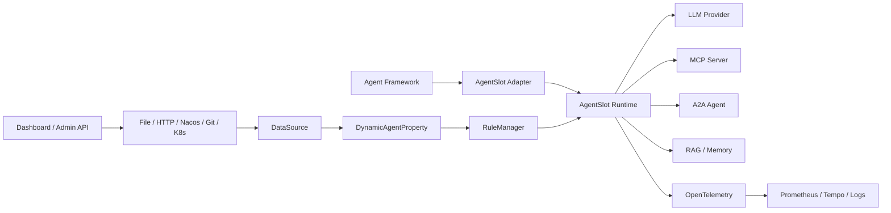
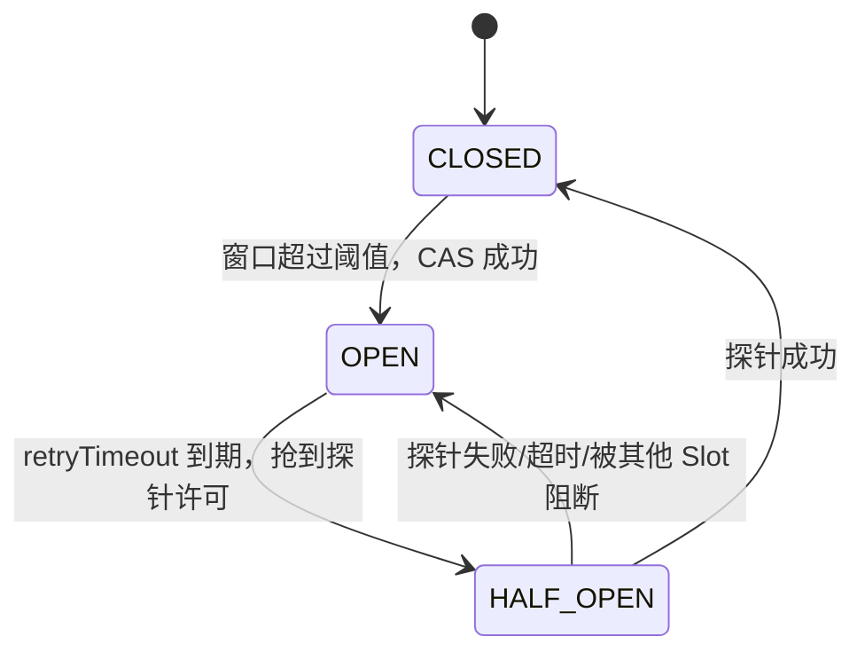
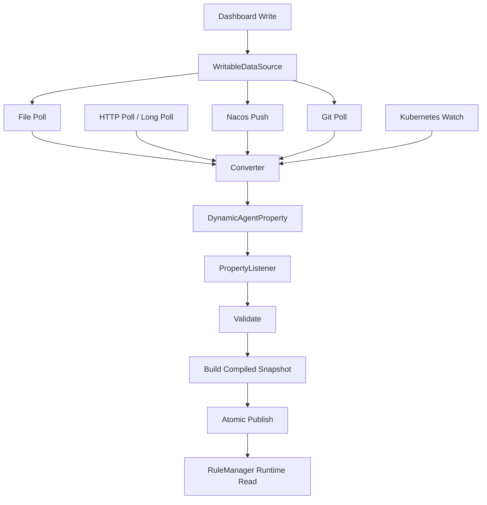

# AgentSlot Runtime 开发设计文档

> 面向 LLM、MCP、A2A 与多 Agent 系统的可插拔执行治理内核  
> 文档状态：Draft / 可进入实现评审  
> 文档版本：0.1.0  
> 编写日期：2026-08-26  
> 建议项目代号：`AgentSlot Runtime`  
> 核心语言：Java 21

---

## 目录

1. [执行摘要](#1-执行摘要)
2. [项目背景与问题定义](#2-项目背景与问题定义)
3. [项目定位、目标与非目标](#3-项目定位目标与非目标)
4. [核心术语](#4-核心术语)
5. [设计原则](#5-设计原则)
6. [总体架构](#6-总体架构)
7. [核心领域模型](#7-核心领域模型)
8. [责任链内核设计](#8-责任链内核设计)
9. [默认 SlotChain 与执行顺序](#9-默认-slotchain-与执行顺序)
10. [各 Slot 详细设计](#10-各-slot-详细设计)
11. [算法与数据结构](#11-算法与数据结构)
12. [动态配置体系](#12-动态配置体系)
13. [规则模型与配置示例](#13-规则模型与配置示例)
14. [MCP、A2A、LLM 与 Agent 框架适配](#14-mcpa2allm-与-agent-框架适配)
15. [异步执行与上下文传播](#15-异步执行与上下文传播)
16. [线程安全、性能与资源保护](#16-线程安全性能与资源保护)
17. [异常、阻断、降级与失败策略](#17-异常阻断降级与失败策略)
18. [可观测性设计](#18-可观测性设计)
19. [安全与隐私](#19-安全与隐私)
20. [模块与代码目录规划](#20-模块与代码目录规划)
21. [公开 API 草案](#21-公开-api-草案)
22. [控制台与管理 API](#22-控制台与管理-api)
23. [测试策略](#23-测试策略)
24. [性能目标与基准测试](#24-性能目标与基准测试)
25. [演示工程](#25-演示工程)
26. [实施路线图](#26-实施路线图)
27. [验收标准](#27-验收标准)
28. [风险清单与应对方案](#28-风险清单与应对方案)
29. [关键架构决策](#29-关键架构决策)
30. [后续演进方向](#30-后续演进方向)
31. [参考资料](#31-参考资料)
32. [附录](#32-附录)

---

## 1. 执行摘要

AgentSlot Runtime 是一个面向现代 Agent 系统的通用执行治理内核。它借鉴 Sentinel 的 `Entry + Context + Node + ProcessorSlotChain + RuleManager + DataSource` 设计，将每一次模型调用、MCP 工具调用、RAG 检索、Memory 读写、子 Agent 创建和 A2A 任务委派抽象为一项可治理资源，并让调用依次通过一条可扩展责任链。

项目的核心价值不是“再造一个 Agent 框架”或“再造一个 AI Gateway”，而是提供以下能力：

- 以责任链组织横切治理能力，Slot 之间保持低耦合；
- 每个 Slot 独立持有规则、指标、算法和阻断语义；
- 支持 SPI 插拔、顺序约束、按场景裁剪和用户自定义 Slot；
- 支持文件轮询、HTTP 拉取/长轮询、Nacos 推送、Git 拉取、Kubernetes Watch、Dashboard 写入等配置方式；
- 所有配置通道最终收束到统一的 `DynamicAgentProperty.updateValue()`；
- 规则在更新线程完成校验和索引构建，以不可变快照原子替换，调用热路径无锁读取；
- 使用滑动窗口、令牌桶、漏桶、Warm-Up、热点参数 LRU、熔断状态机、Little's Law/BBR、预算预留与结算、循环检测等算法；
- 通过适配器接入 MCP、A2A、LLM SDK、Spring AI、LangGraph 等生态，而不把协议细节污染到核心模块。

项目可以理解为：

> 一个面向 Agent 行为的 Sentinel 风格治理运行时，以及一套可以研究、实现、组合和验证不同治理算法的工程平台。

---

## 2. 项目背景与问题定义

### 2.1 Agent 系统与传统 HTTP 服务的差异

传统服务治理通常把一次 HTTP/RPC 请求视为一个边界清晰、成本相近、生命周期较短的调用。Agent 系统则具有以下特征：

1. **调用成本差异巨大**：相同接口可能消耗几十到几十万 Token，也可能触发付费工具或长时间任务。
2. **调用图动态生成**：LLM 在运行时决定调用哪个 Tool、创建几个子 Agent、是否重试以及何时结束。
3. **失败不等于异常**：HTTP 200 可能对应无效答案、空结果、业务校验失败或 Agent 自身放弃。
4. **长任务与异步普遍存在**：MCP Task、A2A Task、流式生成和人工确认可能持续数分钟甚至更久。
5. **重试具有放大效应**：模型重试、框架重试、网关重试和业务重试叠加后可能形成重试风暴。
6. **高基数参数突出**：用户、会话、仓库、查询词、Agent Skill、模型和工具参数组合数量巨大。
7. **资源不是单一 QPS**：需要同时治理请求数、并发数、Token、费用、上下文长度、步骤数和子 Agent 数。
8. **同步 ThreadLocal 不再充分**：调用经常跨线程、跨 Reactor Context、跨进程和跨协议。

### 2.2 当前生态已有能力与缺口

现有 AI Gateway 通常已经具备认证、路由、固定请求限流、Token 限流、重试和可观测性。AgentSlot Runtime 不应重复这些基础能力，而应补充：

- Agent 调用树和资源节点统计；
- 协议无关、可插拔的算法责任链；
- 基于“成功 Agent Step”而非 HTTP 状态的自适应容量控制；
- Tool 参数、Agent Skill、租户和工作流路径级热点治理；
- 模型、工具、远程 Agent 的统一熔断状态机；
- 对循环、重试放大、子 Agent 扇出和预算失控的专用治理；
- 多种规则数据源的统一抽象、热切换与原子生效。

### 2.3 为什么采用 Sentinel 风格

Sentinel 的核心优势不只是某个限流算法，而是把下列机制组合成稳定工程体系：

- `Entry` 定义受保护资源边界；
- `Context` 表达调用来源与调用路径；
- `Node` 承载不同统计粒度；
- `ProcessorSlotChain` 组织治理步骤；
- `StatisticSlot` 统一生产指标，规则 Slot 只消费指标；
- `RuleManager` 将规则编译成适合热路径的数据结构；
- `DataSource → Property → Listener → RuleManager` 解耦规则来源与规则执行；
- SPI、COW、CAS、不可变快照兼顾扩展性与热路径性能。

这些思想与 Agent Runtime 的动态调用图、多维资源治理天然匹配。

---

## 3. 项目定位、目标与非目标

### 3.1 项目定位

AgentSlot Runtime 是一个可嵌入、可 Sidecar 化、可作为外部策略服务部署的 Agent 治理运行时。

支持三种部署形态：

1. **In-Process SDK**：嵌入 Java Agent 应用，开销最低、上下文最完整。
2. **Sidecar/Proxy**：部署在 Agent 与 MCP/A2A/LLM 服务之间，低侵入接入多语言系统。
3. **External Policy Service**：通过 agentgateway ExtMCP 等扩展点执行请求前后治理。

### 3.2 核心目标

- 建立纯 Java、协议无关的 SlotChain 内核；
- 建立同步、异步、流式调用统一的 Entry 生命周期；
- 建立多层资源树和滑动窗口指标体系；
- 实现默认治理 Slot 与对应算法；
- 建立多数据源动态规则系统；
- 提供 MCP、A2A、LLM 和主流 Agent 框架适配扩展点；
- 提供可验证的性能、正确性和故障恢复指标；
- 保证用户可新增 Slot、Rule、Metric、DataSource 与 BlockHandler。

### 3.3 非目标

首期明确不做：

- 不实现通用 Agent 编排 DSL；
- 不负责 Prompt 生成、规划、Memory 或 RAG 业务逻辑；
- 不替代 MCP Server、A2A Server 或 AI Gateway；
- 不在核心模块内绑定 Spring、Reactor、Netty 或特定云厂商；
- 不使用 LLM 作为每次调用的必经判定器；
- 不追求首期精确的跨节点逐请求全局计数；
- 不把规则 Dashboard 作为首个里程碑的核心交付物；
- 不持久化完整 Prompt、Tool Arguments 和模型输出作为默认行为。

---

## 4. 核心术语

| 术语 | 定义 |
|---|---|
| Resource | 一个可治理对象，例如模型、MCP Tool、A2A Skill、RAG 索引或 Agent Spawn |
| Entry | 一次资源访问的生命周期句柄 |
| Invocation | 一次调用的不可变输入描述 |
| Context | 调用链上下文，包含租户、工作流、Agent、Task、Trace 与调用栈 |
| Node | 资源统计节点，可按资源、上下文、调用方或全局聚合 |
| Slot | 责任链中的处理器，负责一种治理能力 |
| SlotChain | 按确定顺序组织的 Slot 集合 |
| Rule | 某类治理行为的声明式配置 |
| RuleManager | 将规则校验、编译、索引并发布为运行时快照的组件 |
| Property | 数据源和规则管理器之间的可观察值 |
| DataSource | 从外部读取或接收配置的组件 |
| Block | 在业务执行前拒绝、延迟、降级或要求重规划 |
| Completion | 调用完成结果，含耗时、Token、费用、错误和业务成功信号 |
| Permit | 对请求、Token、成本或并发资源的使用许可 |
| ResourceKey | 稳定、低基数的资源标识 |
| HotKey | 从调用参数中提取的高基数治理键 |

---

## 5. 设计原则

### 5.1 核心与协议分离

核心模块只认识 `AgentInvocation`、`AgentContext`、`ResourceDescriptor` 和 `Completion`。MCP JSON-RPC、A2A Task、OpenAI 兼容请求等由适配器转换。

### 5.2 统计与决策分离

`StatisticSlot` 只生产统一指标；`FlowSlot`、`CircuitBreakerSlot` 等只消费指标并执行规则。禁止每个规则 Slot 私自重复统计相同数据。

### 5.3 读路径优先

- 规则更新低频，可以加锁；
- 调用判定高频，应使用不可变快照、`volatile`、CAS、`LongAdder`；
- 不在热路径解析 YAML/JSON；
- 不在热路径扫描所有规则；
- 不在热路径进行网络配置拉取。

### 5.4 配置来源无关

RuleManager 不知道规则来自文件、Nacos、Git 还是 K8s；DataSource 不知道谁消费规则。唯一合同是 `AgentProperty<T>`。

### 5.5 显式异步生命周期

不能依赖“方法返回即调用结束”。Entry 必须在异步结果、流终止、Task 终态或明确取消时完成。

### 5.6 默认保守、失败策略可配置

- 安全/权限 Slot 默认 Fail Closed；
- 遥测和审计默认 Fail Open；
- 限流配置不可用时默认使用最后一次有效快照；
- 规则首次加载失败时按规则类型配置 Fail Open/Closed；
- 不允许静默吞掉规则解析错误。

### 5.7 有界状态

Context、Resource、HotKey、Trace、Breaker、Window 等所有运行时状态必须有容量上限、TTL 或淘汰策略。

### 5.8 可解释阻断

每次阻断必须返回稳定的 `reasonCode`、命中规则、资源、重试建议和可选降级目标，让 Agent 可以重规划，而不是只收到模糊异常。

---

## 6. 总体架构

### 6.1 系统上下文



### 6.2 逻辑分层

```text
┌───────────────────────────────────────────────────────────────┐
│ Adapter Layer                                                 │
│ MCP / A2A / LLM / Spring AI / LangGraph / agentgateway       │
├───────────────────────────────────────────────────────────────┤
│ Runtime API                                                   │
│ Entry / Context / Invocation / Completion / BlockDecision     │
├───────────────────────────────────────────────────────────────┤
│ SlotChain                                                     │
│ Context → Node → Statistic → Auth → Flow → HotKey → Breaker   │
│         → BBR → Budget → RetryGuard → LoopGuard → Routing     │
├───────────────────────────────────────────────────────────────┤
│ Algorithm & Metric                                            │
│ LeapArray / TokenBucket / LeakyBucket / WarmUp / LRU / CAS    │
│ CircuitBreaker / Little's Law / Fingerprint / Budget Ledger   │
├───────────────────────────────────────────────────────────────┤
│ Rule Runtime                                                  │
│ RuleManager / CompiledRule / Immutable Snapshot / Index       │
├───────────────────────────────────────────────────────────────┤
│ Configuration                                                 │
│ DataSource / Converter / Property / Listener / Admin Write    │
└───────────────────────────────────────────────────────────────┘
```

### 6.3 控制面与数据面

**数据面**负责每次调用的微秒/毫秒级治理：

- 创建或恢复 Context；
- 查找 SlotChain；
- 获取已编译规则快照；
- 读取指标并执行算法；
- 返回放行、等待、阻断或降级决定；
- 在完成阶段更新统计状态。

**控制面**负责低频配置工作：

- 拉取、监听、解析规则；
- Schema 校验和语义校验；
- 规则编译和索引构建；
- 版本、哈希、审计和回滚；
- 原子发布不可变快照；
- 管理数据源健康状态。

---

## 7. 核心领域模型

### 7.1 ResourceDescriptor

```java
public record ResourceDescriptor(
        ResourceType type,
        String namespace,
        String name,
        String operation,
        Map<String, String> labels
) {
    public String resourceKey() {
        return type + ":" + namespace + ":" + name + ":" + operation;
    }
}

public enum ResourceType {
    LLM,
    MCP_TOOL,
    MCP_RESOURCE,
    A2A_AGENT,
    A2A_SKILL,
    RAG,
    MEMORY,
    AGENT_SPAWN,
    CUSTOM
}
```

要求：

- `resourceKey` 必须稳定、低基数；
- 用户 ID、会话 ID、Prompt 和 Tool 参数不得直接进入 `resourceKey`；
- 高基数字段由 `ParamFlowSlot` 提取为 HotKey；
- Adapter 必须对名称做长度限制和规范化；
- labels 仅允许预注册键，禁止无限扩张。

### 7.2 AgentInvocation

```java
public record AgentInvocation(
        ResourceDescriptor resource,
        InvocationDirection direction,
        int acquireCount,
        Map<String, Object> arguments,
        CostEstimate estimate,
        Instant deadline,
        Map<String, String> metadata
) {}
```

`CostEstimate` 可包含：

- `estimatedInputTokens`；
- `maxOutputTokens`；
- `estimatedCostMicros`；
- `estimatedDurationMillis`；
- `estimatedToolUnits`；
- `spawnCount`。

### 7.3 AgentContext

```java
public interface AgentContext {
    String contextId();
    String tenantId();
    String workflowId();
    String runId();
    String agentId();
    String taskId();
    String traceId();
    EntryFrame currentFrame();
    Optional<Object> attribute(ContextKey<?> key);
    <T> AgentContext with(ContextKey<T> key, T value);
}
```

Context 必须是逻辑不可变对象。调用栈可以由一个并发安全或按作用域隔离的 `EntryFrame` 链表示，不允许多个异步分支共享可变 `currentEntry` 指针。

### 7.4 Completion

```java
public record Completion(
        CompletionStatus status,
        long durationNanos,
        long inputTokens,
        long outputTokens,
        long costMicros,
        Throwable error,
        String outcomeCode,
        Double qualityScore,
        Map<String, String> attributes
) {}
```

`CompletionStatus` 至少包括：

- `SUCCESS`：业务上有效完成；
- `FAILED`：业务或 Agent 任务失败；
- `ERROR`：异常结束；
- `TIMEOUT`：超时；
- `CANCELLED`：取消；
- `BLOCKED`：被本地治理阻断；
- `PARTIAL`：流式或长任务部分完成。

### 7.5 AgentEntry

```java
public interface AgentEntry extends AutoCloseable {
    AgentContext context();
    EntryDecision decision();
    void complete(Completion completion);
    boolean isCompleted();

    @Override
    default void close() {
        complete(Completion.successWithoutUsage());
    }
}
```

Entry 完成操作必须幂等。重复完成只允许第一次生效，并记录调试指标，不能重复释放并发许可或重复扣减线程数。

### 7.6 EntryDecision

```java
public sealed interface EntryDecision {
    record Pass(RouteHint routeHint) implements EntryDecision {}
    record Wait(Duration delay, String reasonCode) implements EntryDecision {}
    record Block(BlockReason reason) implements EntryDecision {}
    record Degrade(RouteHint fallback, BlockReason reason) implements EntryDecision {}
    record RequireApproval(String approvalType, BlockReason reason) implements EntryDecision {}
}
```

---

## 8. 责任链内核设计

### 8.1 ProcessorSlot 接口

```java
public interface ProcessorSlot {
    SlotId id();
    int order();
    Set<SlotId> before();
    Set<SlotId> after();

    void entry(SlotInvocation invocation, SlotChain chain) throws AgentBlockException;

    void exit(SlotCompletion completion, SlotChain chain);
}
```

`order()` 提供默认排序，`before/after` 提供显式拓扑约束。构建时先做拓扑排序；同一拓扑层再按 order 和 SlotId 确定顺序，保证不同 JVM 上结果一致。

### 8.2 LinkedProcessorSlot

为贴近 Sentinel 的编程体验，可额外提供链式基类：

```java
public abstract class AbstractLinkedProcessorSlot implements ProcessorSlot {
    private ProcessorSlot next;

    protected final void fireEntry(SlotInvocation invocation) {
        if (next != null) {
            next.entry(invocation, invocation.chain());
        }
    }

    protected final void fireExit(SlotCompletion completion) {
        if (next != null) {
            next.exit(completion, completion.chain());
        }
    }
}
```

实现时建议由 `DefaultProcessorSlotChain` 统一维护数组或不可变链，避免用户 Slot 直接修改 next 指针。

### 8.3 SlotChainBuilder

```java
public interface SlotChainBuilder {
    ProcessorSlotChain build(ChainBuildContext context);
}
```

构建过程：

1. 通过 Java `ServiceLoader` 或自定义 SPI 加载 SlotFactory；
2. 根据 Profile、ResourceType 和配置过滤 Slot；
3. 校验 SlotId 唯一；
4. 建立 before/after 有向图；
5. 检测环；
6. 进行稳定拓扑排序；
7. 生成不可变 Slot 数组；
8. 计算 chain fingerprint；
9. 缓存到 `ChainRegistry`。

### 8.4 ChainRegistry

Chain 不应默认为每个具体 Tool 创建一份，否则高基数资源会导致内存膨胀。建议缓存键为：

```text
ChainProfileKey = resourceType + adapterType + policyProfile + runtimeVersion
```

真正的资源规则通过 RuleManager 快照查找，而不是固化进 Chain 实例。

### 8.5 入口与退出语义

`entry()` 按正向执行，`exit()` 按反向执行，形成洋葱模型：

```text
entry: A → B → C → business
exit : A ← B ← C ← completion
```

要求：

- Slot 只有成功完成 entry 阶段后才进入退出栈；
- 某 Slot 阻断时，只退出此前已进入的 Slot；
- `StatisticSlot` 需要包裹后续执行，才能同时记录 pass、block、RT 和 error；
- Slot 的 exit 不能掩盖业务异常；
- exit 异常进入诊断通道，除安全场景外不改变原始 Completion；
- 异步调用通过显式完成栈执行退出逻辑，不能依赖线程栈。

### 8.6 Slot 可扩展性

第三方 Slot 必须声明：

- 稳定 SlotId；
- 默认 order；
- before/after 约束；
- 是否是必需 Slot；
- 支持的 ResourceType；
- 使用的 ContextKey；
- 是否创建有界状态；
- Fail Open/Closed 默认值；
- 对应规则类型和指标；
- entry/exit 是否幂等。

---

## 9. 默认 SlotChain 与执行顺序

### 9.1 默认顺序

| 顺序 | Slot | 阶段 | 核心职责 |
|---:|---|---|---|
| -10000 | `ContextSlot` | 前置 | 创建/恢复上下文和调用帧 |
| -9500 | `NodeSelectorSlot` | 前置 | 构建资源×上下文节点 |
| -9000 | `ClusterBuilderSlot` | 前置 | 绑定资源全局聚合节点 |
| -8500 | `StatisticSlot` | 包裹 | 统计 pass/block/RT/error/Token/Cost |
| -7000 | `AuthoritySlot` | 前置 | 身份、租户、Agent、Tool 权限 |
| -6500 | `BudgetSlot` | 前后 | 预算预留和完成后结算 |
| -6000 | `SystemAdaptiveSlot` | 前置 | Runtime 全局过载保护与 BBR |
| -5000 | `FlowSlot` | 前置 | 资源级 QPS/并发/Warm-Up/排队 |
| -4500 | `ParamFlowSlot` | 前后 | 参数级热点限流和并发计数 |
| -4000 | `CircuitBreakerSlot` | 前后 | 熔断通行和完成结果统计 |
| -3500 | `RetryGuardSlot` | 前置 | 限制重试放大和退避策略 |
| -3000 | `LoopDetectionSlot` | 前置 | 重复工具调用、调用环、扇出检测 |
| -2000 | `RoutingSlot` | 前置 | 选择模型、Tool、Agent 或降级目标 |
| -1000 | `AuditSlot` | 前后 | 生成治理审计事件 |

### 9.2 顺序理由

- Context 与 Node 必须先于统计和规则；
- Statistic 必须包裹所有治理 Slot，才能统计阻断和完成结果；
- Authority 必须早于可能产生等待或消耗预算的 Slot；
- Budget 先预留，避免并发请求同时穿透硬预算；
- SystemAdaptive 先保护全局，再执行资源级精细治理；
- Flow 先限制资源总量，ParamFlow 再限制具体热点键；
- CircuitBreaker 在真实执行前检查状态，在完成阶段消费结果；
- Routing 在治理通过后选择目标，避免为最终会被拒绝的调用执行昂贵路由计算；
- Audit 记录最终决策与目标，但不保存敏感正文。

### 9.3 可选 Profile

建议提供：

- `minimal`：Context、Statistic、Flow、CircuitBreaker；
- `mcp`：增加 ParamFlow、Authority、RetryGuard；
- `a2a`：增加 Budget、LoopDetection、SystemAdaptive；
- `llm`：增加 Token/Cost Budget、模型 Routing；
- `full`：启用全部默认 Slot；
- `custom`：由用户显式声明。

---

## 10. 各 Slot 详细设计

## 10.1 ContextSlot

### 目标

为当前调用创建确定的逻辑上下文和父子调用帧，解决跨线程、跨协议与子 Agent 委派下的调用链关联。

### 输入

- Adapter 提供的 tenant/workflow/run/agent/task/trace 信息；
- W3C Trace Context；
- 父级 `AgentContext`；
- MCP `_meta` 或 A2A `contextId/taskId`。

### 算法与数据结构

- 不可变 Context；
- 父指针形式的持久化调用栈；
- `ContextRegistry` 采用有界缓存和 TTL；
- 缺失 ID 时生成 UUIDv7/ULID；
- Trace ID 和业务 Run ID 分离。

### 关键约束

- 不把 Context 仅存入 ThreadLocal；
- ThreadLocal 只作为同步桥接；
- 异步分支通过显式 Context Capture/Restore；
- Context 数量超过上限时进入退化模式：保留当前调用的轻量上下文但不缓存全局树。

### 输出

- 当前 `EntryFrame`；
- 归一化的上下文字段；
- 下游 Slot 可读取的 ContextKey。

## 10.2 NodeSelectorSlot

### 目标

建立“资源 × 调用上下文”的统计节点，使同一 Tool 在不同 Agent、Workflow 或调用方下可以应用不同规则。

### 节点键

```text
ContextNodeKey = resourceKey + contextName + callerAgentId
```

默认不得包含 userId、sessionId、raw arguments 等高基数字段。

### 数据结构

- `ConcurrentHashMap<ContextNodeKey, ContextNode>`；
- COW 或分段并发清理；
- TinyLFU/LRU 可作为未来替代；
- 最大节点数与空闲 TTL 双重保护。

### 超限策略

- 停止创建细粒度节点；
- 回退到 ClusterNode；
- 记录 `agentslot.node.degraded`；
- 默认不直接阻断业务。

## 10.3 ClusterBuilderSlot

### 目标

为每个低基数 Resource 创建全局聚合节点，用于资源级 QPS、RT、成功率、并发、Token 和成本统计。

### 双写机制

一次调用同时写：

1. `ContextNode`：资源×上下文视角；
2. `ClusterNode`：资源全局视角；
3. 可选 `RuntimeNode`：整个进程/实例视角。

### 资源保护

- 资源总数默认上限建议 10,000，可配置；
- 新资源超过上限时映射到 `OTHER::<type>` 聚合节点；
- 禁止无限创建 Breaker、Window 和 Rule Container。

## 10.4 StatisticSlot

### 目标

统一记录治理算法需要的指标，不做具体限流或熔断决策。

### entry 阶段

- 先调用后续 Slot；
- 后续 Slot 全部通过后增加 pass 与 inflight；
- 若后续 Slot 抛出 BlockException，增加 block；
- 注册 Completion 回调。

### completion/exit 阶段

- 计算总 RT；
- 减少 inflight；
- 按 CompletionStatus 记录 success/error/timeout/cancel；
- 记录 input/output/reasoning/cache Token；
- 记录成本与 Tool Units；
- 更新最大成功吞吐和最小成功 RT 统计；
- 将结果通知 CircuitBreaker、Budget 和 Param 并发计数器。

### 算法

- LeapArray 风格滑动窗口；
- `LongAdder`/`Striped64` 降低高并发写竞争；
- RT 使用总和+计数、直方图或 DDSketch；
- BBR 的最小成功 RT 使用窗口最小值；
- 不将 BLOCKED 计入下游错误率。

## 10.5 AuthoritySlot

### 目标

基于 tenant、agent、resource、skill、tool、operation、environment 执行确定性授权。

### 规则模式

- allowlist；
- denylist；
- 默认策略；
- 条件表达式；
- 需要人工审批；
- 只读/写操作分类。

### 算法

- 规则预编译为多级 Map/Trie；
- 精确匹配优先于通配；
- deny 优先于 allow；
- 禁止在热路径解释自然语言策略；
- CEL/表达式必须预编译并设置执行预算。

### 失败策略

默认 Fail Closed。配置不可用时使用最后有效策略；无任何有效快照时由 `bootstrapPolicy` 决定。

## 10.6 BudgetSlot

### 目标

控制一次 Run、Agent、Tenant 和时间窗口内的 Token、费用、步骤、Tool 调用和子 Agent 数。

### 两阶段预算

```text
请求前：reserve(estimatedCost)
请求后：reconcile(actualCost - reservedCost)
取消时：release(unusedReservation)
```

### 层级预算

```text
tenant
  └── workflow
        └── run
              └── agent
                    └── resource
```

所有层级均通过才允许请求。预算预留顺序从根到叶，释放顺序从叶到根。首期可使用固定顺序锁或无锁原子扣减，避免死锁。

### 算法

- 时间窗口预算：令牌桶；
- 整个 Run 的硬上限：单调递增 Ledger；
- 未知输出 Token：使用 `maxOutputTokens` 或保守估计预留；
- 完成后按真实用量结算；
- 预留 TTL 防止进程异常导致永久占用；
- 费用统一使用整数微单位，禁止浮点累计。

### 阻断结果

返回剩余预算、重置时间、建议降低模型/输出长度或终止 Run。

## 10.7 SystemAdaptiveSlot

### 目标

从 Runtime 全局视角保护进程和下游资源，避免静态阈值在负载波动时大量误杀或放过过载。

### 保护维度

- 当前入站 QPS；
- 当前在途 Step/Task；
- 平均与 P95 RT；
- CPU；
- JVM Heap/GC Pause；
- Event Loop/Executor Queue；
- Token throughput；
- 下游成功吞吐；
- 可选 Load Average。

### Agent-BBR

对于每种资源单位分别计算，禁止把“任务数”和“Token 数”混在同一公式中：

```text
stepCapacity = maxSuccessfulStepsPerSecond × minSuccessfulStepRtSeconds

拒绝条件：
currentInflightSteps > 1
AND currentInflightSteps > max(minConcurrency, stepCapacity × safetyFactor)
```

物理意义是 Little's Law：

```text
inflight ≈ throughput × latency
```

### 关键改造

Sentinel 关注成功请求；AgentSlot 必须关注“成功完成的 Step/Task”。以下结果不得贡献成功带宽：

- 网络成功但 Task 状态失败；
- 输出无法通过业务 Validator；
- 因循环上限而终止；
- 超时或被取消；
- 仅生成了中间流式片段但未完成。

### 稳定性措施

- 冷启动最小样本数；
- `currentInflight > 1` 防止完全饿死；
- 容量下限和上限；
- safetyFactor 默认 0.8~1.0；
- 最大成功吞吐和最小 RT 使用不同时间尺度；
- 容量变化使用 EWMA 或上下行不同速率；
- 配置更新不清空历史指标，除非资源单位或窗口结构变化。

## 10.8 FlowSlot

### 目标

对低基数资源执行 QPS、并发、Token Rate 和 Tool Unit 流量控制。

### 控制器策略

| 控制器 | 算法 | 场景 | 超阈值行为 |
|---|---|---|---|
| RejectController | 滑动窗口计数器 | 通用快速失败 | 立即阻断 |
| TokenBucketController | 令牌桶 | 允许一定突发 | 无令牌时阻断/等待 |
| WarmUpController | 冷启动令牌模型 | 新模型、新 Tool、扩容实例 | 逐步提升阈值 |
| ThrottlingController | 漏桶/虚拟调度时间 | 平滑昂贵 Tool 调用 | 排队或超时 |
| WarmUpRateLimiterController | Warm-Up + 漏桶 | 冷启动且需匀速 | 排队或超时 |
| ConcurrencyController | 原子计数/信号量 | 长任务、流式请求 | 无许可时阻断 |

### 控制单位

- `REQUEST`；
- `INPUT_TOKEN`；
- `OUTPUT_TOKEN`；
- `TOTAL_TOKEN`；
- `COST_MICRO`；
- `TOOL_UNIT`；
- `CONCURRENT_STEP`；
- `CONCURRENT_TASK`。

### 排队约束

- 不在 Netty EventLoop 或 Reactor 非阻塞线程直接 `sleep`；
- 同步环境使用可中断等待；
- 异步环境返回 `Wait` 决策和调度时间；
- 排队必须受 deadline 和 `maxQueueingTime` 限制；
- 排队本身计入等待指标但不计入下游 RT。

## 10.9 ParamFlowSlot

### 目标

针对 Tool 参数、用户、仓库、数据库、Agent Skill、模型等热点键独立限流，避免一个热点影响整个资源。

### 参数提取

规则不能依赖 Java 参数位置，必须支持协议无关 Selector：

```text
$.arguments.repo
$.arguments.database
$.metadata.tenantId
$.resource.labels.model
$.a2a.skillId
$.mcp.toolName
```

### HotKey 规范化

- 字符串裁剪和 Unicode 规范化；
- 可选 HMAC/Hash，避免保存敏感原文；
- 集合参数逐元素或整体指纹，由规则指定；
- null 策略显式配置；
- 高风险参数禁止直接作为 Metrics Label。

### 算法

- 每 HotKey 独立令牌桶；
- 每 HotKey 独立漏桶虚拟时间；
- 每 HotKey 并发计数；
- CAS + 不可变 TokenState；
- 有界 LRU/ConcurrentLinkedHashMap；
- 规则级最大 Key 数；
- 特例参数覆盖默认阈值。

### 淘汰语义

LRU 淘汰会丢失该 Key 的历史限流状态，因此：

- 淘汰后按“新桶”处理可能产生额外突发；
- 对安全敏感硬配额不能依赖本地 LRU；
- 可为关键 Key 配置 pinned 状态；
- 记录 eviction 指标；
- 容量计算必须和持续时间、预期基数关联。

## 10.10 CircuitBreakerSlot

### 目标

隔离持续变慢或失败的模型、MCP Tool、A2A Agent、Skill、RAG 和 Memory 后端。

### 状态机



### 触发策略

- 慢调用比例；
- 异常比例；
- 异常数量；
- Task 失败比例；
- 超时比例；
- 业务 Validator 失败比例；
- 可选成本异常率。

### 并发安全

- 状态使用 `AtomicReference<State>`；
- 所有转换使用 CAS；
- HALF_OPEN 默认只允许一个探针；
- 失败线程不执行重复副作用；
- 状态变化通过 Observer 发布事件。

### Probe 补偿

探针通过 CircuitBreakerSlot 后，如果被后续 Budget/Loop/Routing Slot 阻断，必须通过 Entry 终止回调把 HALF_OPEN 恢复到 OPEN，避免永远卡在 HALF_OPEN。

### 规则热更新状态复用

RuleManager 构建新 Breaker 集合时：

- 规则身份和影响状态机的字段均未变化：复用原实例；
- 阈值、窗口、策略变化：创建新实例；
- 仅 description、labels 变化：复用状态；
- 删除规则：等待在途 Entry 完成后回收；
- 新增规则：从 CLOSED 开始，可配置预热期。

## 10.11 RetryGuardSlot

### 目标

防止 Agent、SDK、Gateway 和业务层多级重试相互叠加。

### 上下文字段

- logicalCallId；
- attempt；
- maxAttempts；
- parentAttempt；
- retryReason；
- previousTarget；
- cumulativeCost；
- cumulativeDuration。

### 算法

- 每 logicalCallId 计数；
- 指数退避 + Full Jitter；
- Retry Budget：重试流量不得超过成功流量的一定比例；
- 对不可重试错误立即阻断；
- Breaker OPEN、权限拒绝、预算不足默认不可重试；
- Tool 有副作用且无幂等键时禁止自动重试；
- 截止时间不足以完成下一次尝试时直接停止。

### Retry Budget 示例

```text
retryTokens = floor(successfulRequests × retryRatio) + minRetryBurst
每次重试消耗 1 个 retryToken
```

## 10.12 LoopDetectionSlot

### 目标

检测 Agent 重复执行、调用环、无进展循环和子 Agent 扇出爆炸。

### 调用指纹

```text
fingerprint = hash(
    agentId,
    resourceKey,
    normalizedArguments,
    parentResourceKey,
    outcomeClass
)
```

不直接保存敏感参数，默认保存 HMAC-SHA256 指纹。

### 检测算法

1. **连续重复检测**：同一指纹连续出现 N 次；
2. **窗口频次检测**：最近 T 秒同一指纹超过阈值；
3. **调用路径环检测**：当前资源已出现在祖先帧中且超过允许深度；
4. **无进展检测**：输出摘要或状态版本连续不变；
5. **扇出检测**：单父任务创建的活动子 Agent 超过阈值；
6. **总步骤上限**：Run/Task/Agent 维度硬限制。

### 数据结构

- 每 Run 有界 RingBuffer；
- `Map<Fingerprint, CounterWindow>`；
- 祖先帧集合或 Bloom Filter + 精确短链复核；
- TTL 在 Run 终止后清理；
- 容量超限时优先保留重复度最高的指纹。

### 误判控制

- 读取分页、轮询 Task 状态等合法重复通过 operation profile 放宽；
- 参数中的 cursor、timestamp 等可配置为归一化忽略字段；
- 有进展版本号变化时重置连续重复计数；
- 阻断结果提示 Agent 改变计划，而不是简单建议重试。

## 10.13 RoutingSlot

### 目标

基于前序 Slot 产生的健康度、预算和策略选择模型、Tool 实例或远程 Agent。

### 路由因素

- Authority 可访问集合；
- Breaker 状态；
- BBR 剩余容量；
- 预算和模型单价；
- 数据驻留要求；
- Agent Skill/能力声明；
- 任务所需上下文窗口；
- 粘性需求与幂等性。

### 算法

首期支持：

- 优先级路由；
- 加权轮询；
- 最小在途请求；
- Power of Two Choices；
- 健康实例过滤；
- 固定降级链。

路由结果写入 Context，不在核心 Slot 中直接发起网络请求。

## 10.14 AuditSlot

### 目标

生成结构化治理事件，记录“为什么放行、阻断、等待或降级”。

### 最小事件字段

- timestamp；
- traceId/runId/taskId；
- tenantId/agentId；
- resourceKey；
- decision；
- reasonCode；
- ruleId/ruleVersion；
- algorithm snapshot；
- route/fallback；
- duration；
- redacted attributes。

### 约束

- 默认不保存 Prompt、Tool 原始参数和模型输出；
- 审计写入失败默认不阻断调用；
- 安全场景可配置本地同步 append-only 日志；
- 事件投递采用有界队列和批处理；
- 队列满时丢弃低优先级 PASS 事件，优先保留 BLOCK/DEGRADE。

---

## 11. 算法与数据结构

### 11.1 LeapArray 风格滑动窗口

窗口参数：

```text
intervalMs     总统计周期
sampleCount    桶数量
bucketLength   intervalMs / sampleCount
```

根据当前时间计算桶索引：

```text
timeId = currentTimeMillis / bucketLength
index  = timeId % sampleCount
windowStart = currentTimeMillis - currentTimeMillis % bucketLength
```

桶复用时需要 CAS 重置窗口开始时间和计数器。读取快照时只聚合仍处于统计周期内的桶。

建议计数项：

- pass；
- block；
- success；
- error；
- timeout；
- cancel；
- input/output tokens；
- costMicros；
- durationNanos；
- slowCount。

### 11.2 令牌桶

状态：

```text
TokenState(lastRefillNanos, availableTokens)
```

公式：

```text
elapsed = now - lastRefill
refill = elapsed × tokensPerSecond
available = min(capacity, oldAvailable + refill)
newAvailable = available - acquire
通过条件：newAvailable >= 0
```

实现要求：

- 使用 `System.nanoTime()` 计算单调时间；
- CAS 更新不可变状态；
- 容量和速率使用定点数避免浮点误差；
- 支持 burst capacity；
- 时钟大幅跳变不产生超大补充；
- acquireCount 必须有上限。

### 11.3 漏桶/虚拟调度时间

```text
costTime = acquire / rate
expectedPassTime = max(now, latestPassTime) + costTime
waitTime = expectedPassTime - now
```

通过条件：

```text
waitTime <= maxQueueingTime
AND expectedPassTime <= deadline
```

CAS 成功后返回调度时刻。异步调用由 Scheduler 在对应时刻继续执行。

### 11.4 Warm-Up

目标是避免新模型实例、新 MCP Server 或刚恢复的 Agent 被瞬时流量击穿。

实现思路：

- 初始阈值为稳定阈值的 `1/coldFactor`；
- 在 warmupPeriod 内按 stored permits 或线性/平滑曲线提高阈值；
- 完成率和错误率恶化时暂停升速；
- Breaker 从 HALF_OPEN 恢复后可重新进入短 Warm-Up。

### 11.5 热点参数 LRU

每条 ParamFlowRule 持有独立有界缓存：

```text
RuleId -> CacheMap<HotKeyHash, AlgorithmState>
```

容量由配置和全局上限共同决定：

```text
effectiveCapacity = min(rule.capacity, runtime.maxHotKeysPerRule)
```

全局还需要限制：

```text
sum(all rule hot-key states) <= runtime.maxHotKeyStates
```

### 11.6 熔断窗口

触发条件示例：

```text
total >= minRequestAmount
AND slowCount / total >= slowRatioThreshold
```

或：

```text
total >= minRequestAmount
AND errorCount / total >= errorRatioThreshold
```

熔断统计必须区分：

- 下游错误；
- 本地阻断；
- 用户取消；
- Deadline 到期；
- Validator 失败；
- 可重试与不可重试错误。

### 11.7 Agent-BBR

推荐维护两个窗口：

- `bandwidthWindow`：较长，用于寻找最大成功吞吐；
- `rtWindow`：较短或中等，用于寻找近期最小成功 RT。

```text
bw = max(successfulStepQps over bandwidthWindow)
minRt = min(successfulStepRt over rtWindow)
baseCapacity = bw × minRt
effectiveCapacity = clamp(baseCapacity × safetyFactor, min, max)
```

为了避免容量抖动：

```text
if newCapacity > oldCapacity:
    capacity = old + upGain × (new-old)
else:
    capacity = old + downGain × (new-old)
```

通常 `downGain > upGain`，过载时快速收缩，恢复时谨慎扩张。

### 11.8 预算预留与结算

```text
reserved = estimate(input) + maxOutput + safetyMargin
if ledger.remaining < reserved: block
else CAS remaining -= reserved

on completion:
actual = inputTokens + outputTokens
delta = reserved - actual
remaining += delta
```

如果 actual > reserved，需要补扣差额；若余额不足，不撤回已经返回的响应，而是记录 overdraw 并阻断后续请求。硬实时成本场景必须在请求参数中限制最大输出。

### 11.9 循环检测

短周期精确检测优先于复杂机器学习：

- RingBuffer 保存最近 N 个指纹；
- HashMap 统计窗口频次；
- Ancestor Set 检测路径环；
- Progress Token 判断状态是否前进；
- 可选 SimHash/MinHash 检测近似重复，但不能作为首期硬阻断的唯一依据。

---

## 12. 动态配置体系

### 12.1 总体数据流



### 12.2 核心接口

```java
public interface AgentProperty<T> {
    T value();
    void addListener(PropertyListener<T> listener);
    void removeListener(PropertyListener<T> listener);
}

public interface PropertyListener<T> {
    void configLoad(ConfigEnvelope<T> value);
    void configUpdate(ConfigEnvelope<T> value);
}

public interface ReadableDataSource<S, T> extends AutoCloseable {
    S readSource() throws Exception;
    Converter<S, T> converter();
    AgentProperty<T> property();
    DataSourceHealth health();
}

public interface WritableDataSource<T> {
    WriteResult write(ConfigEnvelope<T> value) throws Exception;
}

public interface Converter<S, T> {
    T convert(S source) throws ConfigException;
}
```

### 12.3 DynamicAgentProperty

关键字段：

```java
final class DynamicAgentProperty<T> implements AgentProperty<T> {
    private final CopyOnWriteArraySet<PropertyListener<T>> listeners;
    private volatile ConfigEnvelope<T> current;
}
```

`updateValue()` 流程：

1. 校验 envelope 基础字段；
2. 比较 version/hash；
3. 丢弃旧版本；
4. 相同 hash 直接返回幂等成功；
5. 串行化同一 Property 的更新；
6. 通知所有 Listener；
7. Listener 成功后切换 current；
8. 发布成功/失败事件；
9. 保留最近 N 个有效版本用于回滚。

需要明确选择事务语义。首期建议同一 Property 的 Listener 要么全部成功，要么不发布新 current；不同 RuleType 独立更新。

### 12.4 ConfigEnvelope

```java
public record ConfigEnvelope<T>(
        String namespace,
        String ruleType,
        long version,
        String contentHash,
        Instant createdAt,
        String sourceId,
        T payload,
        Map<String, String> metadata
) {}
```

版本比较原则：

- 同 sourceId 使用单调 version；
- 切换 source 时使用 source epoch；
- hash 基于规范化后的规则内容；
- 时间戳只用于审计，不作为唯一冲突依据。

### 12.5 RuleManager

```java
public interface RuleManager<R extends Rule, C extends CompiledRule> {
    RuleType ruleType();
    ValidationResult validate(List<R> rules);
    RuleSnapshot<C> compile(ConfigEnvelope<List<R>> envelope);
    void publish(RuleSnapshot<C> snapshot);
    RuleSnapshot<C> currentSnapshot();
}
```

`publish()` 只做一次 `volatile`/`AtomicReference` 替换。所有昂贵工作必须在 compile 阶段完成。

### 12.6 数据源实现

#### 12.6.1 FileRefreshableDataSource

- 定时检查 `lastModified + size + optional checksum`；
- 使用 WatchService 只作加速提示，仍保留周期校验；
- 防抖，避免编辑器临时文件导致多次刷新；
- 读取到半写文件时重试；
- 推荐原子 rename 发布配置；
- 支持 JSON/YAML；
- 默认刷新 3 秒，可配置随机抖动。

#### 12.6.2 HttpPollingDataSource

- 支持 `ETag/If-None-Match`；
- 支持 `Last-Modified/If-Modified-Since`；
- 支持长轮询；
- 指数退避和 Full Jitter；
- 明确连接、读取、总超时；
- TLS 和服务身份校验；
- 304 不触发规则重建；
- 响应体大小上限。

#### 12.6.3 NacosDataSource

- Listener 接收推送；
- 推送线程只负责入队，不做重编译；
- 每 RuleType 使用单线程更新执行器保证顺序；
- 队列有界；
- 高频更新可采用 latest-wins/DiscardOldest，但必须保留审计；
- 断连后使用最后有效快照；
- 重连后主动全量校准。

#### 12.6.4 GitDataSource

- 周期 fetch 指定分支；
- 以 commit SHA 作为 source version；
- 支持目录级规则；
- 只接受签名提交可作为安全选项；
- Pull Request 作为审批流程；
- 回滚等于切换到历史 commit；
- 不在 Runtime 热路径执行 Git 命令。

#### 12.6.5 KubernetesDataSource

- 监听 CRD；
- 使用 `resourceVersion` 保序；
- Watch 断开后执行 List-Watch 恢复；
- 处理 410 Gone；
- Namespace 隔离；
- Admission Webhook 做 Schema/语义校验；
- Controller 状态回写 lastAppliedVersion 和错误信息。

#### 12.6.6 Dashboard Push

生产环境不建议 Dashboard 直接只改客户端内存。推荐流程：

```text
Dashboard → WritableDataSource → 持久化配置中心
          → DataSource Listener/Poll → Runtime
```

Dashboard 写入必须带：

- expectedVersion；
- operator；
- reason；
- change ticket；
- dry-run 结果；
- 可回滚版本。

### 12.7 数据源优先级与切换

同一 RuleType 默认只允许一个 Active Source，不做隐式合并。原因是多源合并会引入难以解释的覆盖和删除语义。

切换流程：

1. 新数据源启动并完成首次读取；
2. 校验并编译候选快照；
3. 比较命名空间和 RuleType；
4. 原子注册新 Property；
5. 立即触发 `configLoad`；
6. 新快照成功发布；
7. 停止旧数据源；
8. 记录 source epoch 变化。

---

## 13. 规则模型与配置示例

### 13.1 Rule 公共字段

```java
public interface Rule {
    String id();
    String namespace();
    String resourcePattern();
    ResourceType resourceType();
    boolean enabled();
    int priority();
    Map<String, String> labels();
}
```

建议公共字段：

- `id`：命名空间内唯一且稳定；
- `resource`：精确、glob 或受限正则；
- `scope`：tenant/workflow/agent/resource/global；
- `priority`；
- `enabled`；
- `effectiveFrom/effectiveUntil`；
- `description`；
- `failMode`；
- `labels`。

### 13.2 完整 YAML 示例

```yaml
apiVersion: agentslot.io/v1alpha1
kind: AgentSlotRuleSet
metadata:
  namespace: coding-agents
  version: 42
  source: nacos://agentslot/coding-prod

spec:
  flowRules:
    - id: github-search-flow
      resourceType: MCP_TOOL
      resource: "mcp:github:search_repositories:call"
      metric: REQUEST
      strategy: WARM_UP_RATE_LIMITER
      threshold: 20
      burst: 10
      warmupPeriod: 30s
      maxQueueingTime: 2s

  paramFlowRules:
    - id: github-search-by-tenant
      resourceType: MCP_TOOL
      resource: "mcp:github:search_repositories:call"
      selector: "$.metadata.tenantId"
      strategy: TOKEN_BUCKET
      threshold: 5
      burst: 2
      duration: 1s
      cacheCapacity: 10000
      hashKey: true
      overrides:
        - valueHash: "hmac:premium-tenant"
          threshold: 20

  circuitBreakerRules:
    - id: github-search-slow
      resourceType: MCP_TOOL
      resource: "mcp:github:search_repositories:call"
      strategy: SLOW_RATIO
      statInterval: 30s
      minRequestAmount: 20
      slowThreshold: 3s
      threshold: 0.5
      openDuration: 20s
      halfOpenPermits: 1

  systemRules:
    - id: runtime-agent-bbr
      scope: GLOBAL
      strategy: AGENT_BBR
      bandwidthWindow: 60s
      rtWindow: 10s
      minSamples: 20
      minConcurrency: 2
      maxConcurrency: 200
      safetyFactor: 0.9
      downGain: 0.8
      upGain: 0.2

  budgetRules:
    - id: coding-run-budget
      scope: RUN
      maxTotalTokens: 200000
      maxCostMicros: 5000000
      maxSteps: 200
      maxAgentSpawns: 20
      reservationTtl: 10m

  retryRules:
    - id: github-retry
      resource: "mcp:github:*:call"
      maxAttempts: 3
      retryRatio: 0.1
      minRetryBurst: 2
      backoff:
        type: EXPONENTIAL_FULL_JITTER
        base: 200ms
        max: 5s

  loopRules:
    - id: coding-loop-guard
      scope: RUN
      maxSteps: 200
      maxDepth: 12
      maxActiveChildrenPerParent: 8
      consecutiveSameFingerprint: 3
      sameFingerprintInWindow: 6
      window: 60s
      ignoreFields:
        - "$.arguments.cursor"
        - "$.arguments.timestamp"
```

### 13.3 规则匹配优先级

1. 精确资源匹配；
2. 具体 scope；
3. priority 更高；
4. pattern 更具体；
5. ruleId 字典序，保证确定性。

是否允许多条规则同时生效由 RuleType 决定：

- Authority：所有匹配规则组合，deny 优先；
- Flow：默认所有匹配规则均需通过；
- ParamFlow：每个 selector 分别执行；
- CircuitBreaker：不同策略可并存；
- Budget：所有层级预算均需通过；
- Routing：只选择最高优先级路由规则。

---

## 14. MCP、A2A、LLM 与 Agent 框架适配

### 14.1 Adapter SPI

```java
public interface InvocationAdapter<I, O> {
    AdapterType type();
    AgentInvocation toInvocation(I request, AdapterContext context);
    Completion toCompletion(O response, Throwable error, long durationNanos);
    Object applyDecision(EntryDecision decision, I request);
}
```

### 14.2 MCP 适配

MCP `2026-07-28` 的请求是自描述和无协议级会话的，并通过以下头暴露路由关键信息：

- `MCP-Protocol-Version`；
- `Mcp-Method`；
- `Mcp-Name`；
- 可选 `Mcp-Param-*`。

映射建议：

```text
tools/call + toolName     → MCP_TOOL
resources/read + uri      → MCP_RESOURCE
prompts/get + promptName  → MCP_PROMPT（可扩展类型）
tasks/get/update/cancel   → MCP_TASK
```

ResourceKey 只包含 method/name/target，不包含原始参数。参数由 ParamFlow selector 处理。

MCP Adapter 需要处理：

- 2026 无会话请求；
- 老版本兼容层；
- MRTR 的 `input_required`；
- Task 扩展的长生命周期；
- JSON-RPC 错误与 HTTP 错误区分；
- Streamable HTTP；
- Tool 副作用和幂等信息；
- `tools/list` 等缓存型请求与实际执行请求使用不同 Profile。

### 14.3 agentgateway ExtMCP 适配

agentgateway 可在 MCP 方法级调用外部 gRPC 策略服务。AgentSlot 可以实现 ExtMCP Server：

```text
agentgateway
   → ExtMCP Request Phase
      → AgentSlot entry()
      → PASS / DENY / MUTATE
   → MCP Backend
   → ExtMCP Response Phase
      → AgentSlot complete()
```

注意：请求和响应阶段需要通过稳定 correlation ID 关联 Entry。Entry 状态必须有 TTL，响应缺失时由超时清理并完成为 TIMEOUT/UNKNOWN。

### 14.4 A2A 适配

A2A v1.0 中适合治理的维度：

- Agent Card identity；
- supportedInterfaces；
- skillId；
- tenant；
- Task ID/context ID；
- SendMessage/GetTask/CancelTask/Subscribe；
- Task terminal status；
- streaming/push notification。

映射建议：

```text
A2A remote agent endpoint → A2A_AGENT
AgentCard skill           → A2A_SKILL
Task                      → 长生命周期 AgentEntry
Message                   → Step 或短 Entry
```

Task 只有到达终态才完成。轮询 `GetTask` 不得被误计为多个业务 Task，但可以作为独立 transport resource 统计。

### 14.5 LLM 适配

ResourceKey：

```text
llm:<provider>:<model>:<operation>
```

完成阶段采集：

- input/output/cache/reasoning Token；
- 首 Token 延迟；
- 总 RT；
- finish reason；
- provider error；
- estimated/actual cost；
- streaming 是否完整结束。

### 14.6 Spring AI / LangChain4j / LangGraph 等

框架适配器只负责：

- 从框架回调构建 Invocation；
- 捕获父子 Agent 和 Tool 调用关系；
- 传播 Context；
- 将 BlockDecision 转换为框架可理解的异常/ToolResult；
- 在成功、错误、取消和流结束时完成 Entry。

禁止在核心模块依赖任何框架类型。

---

## 15. 异步执行与上下文传播

### 15.1 为什么不能照搬 ThreadLocal

Agent 调用经常使用 `CompletionStage`、Reactor、Kotlin Coroutine、虚拟线程、SSE 和回调。ThreadLocal 在切线程后会丢失，也无法表达多个并行子调用。

### 15.2 推荐模型

- `AgentContext` 显式作为调用参数或封装在 `ContextCarrier`；
- 同步代码提供 `ContextScope implements AutoCloseable`；
- Reactor 使用 `ContextView` Bridge；
- OpenTelemetry 使用标准 Context；
- 虚拟线程可使用 ScopedValue 适配，但核心不依赖预览 API；
- 子 Agent 分支从父 Context 派生新不可变 Context。

### 15.3 CompletionStage 示例

```java
AgentEntry entry = runtime.enter(invocation, context);

if (!(entry.decision() instanceof EntryDecision.Pass)) {
    return CompletableFuture.failedFuture(mapDecision(entry.decision()));
}

long start = System.nanoTime();
return callRemoteAsync()
        .whenComplete((response, error) -> {
            Completion completion = adapter.toCompletion(
                    response,
                    error,
                    System.nanoTime() - start
            );
            entry.complete(completion);
        });
```

### 15.4 流式调用

- Entry 在订阅成功时不算完成；
- 首 Token 记录独立指标；
- 正常 `onComplete` 才算 SUCCESS；
- `onError` 为 ERROR；
- 客户端取消为 CANCELLED；
- 流式输出中途超过预算时是否中断由规则配置；
- BudgetSlot 支持分片增量结算；
- 完成回调必须 exactly-once。

---

## 16. 线程安全、性能与资源保护

### 16.1 热路径并发策略

| 状态 | 推荐机制 |
|---|---|
| RuleSnapshot | `volatile`/`AtomicReference` 不可变对象 |
| Counter | `LongAdder` |
| Breaker State | `AtomicReference` + CAS |
| Token Bucket | `AtomicReference<TokenState>` |
| Leaky Bucket | `AtomicLong latestPassTime` |
| Inflight | `AtomicInteger`/Striped Counter |
| Listener | `CopyOnWriteArraySet` |
| Resource Nodes | `ConcurrentHashMap` + 有界清理 |
| HotKey Cache | 有界并发 LRU |
| Config Update | RuleType 级单线程或锁 |

### 16.2 禁止事项

- 热路径使用全局 synchronized；
- 每次调用解析规则文本；
- 将 Prompt/Arguments 作为 Map Key；
- 无限缓存 Context/Task/Resource；
- 在 EventLoop 阻塞等待；
- 每个请求同步上报遥测；
- 配置更新时原地修改可见 Map；
- 规则刷新时无条件重置 Breaker 状态。

### 16.3 默认资源上限

初始建议值，需通过压测校准：

| 项目 | 默认上限 |
|---|---:|
| Resource Node | 10,000 |
| Context Node | 50,000 |
| HotKey State/Rule | 10,000 |
| HotKey State/Runtime | 200,000 |
| Active Long Task Entry | 100,000 |
| Audit Queue | 50,000 |
| Config Payload | 5 MiB |
| Rule Count/Type | 20,000 |
| Loop Fingerprint/Run | 1,024 |

### 16.4 清理机制

- 时间轮或分片定时扫描；
- 每轮限制最大清理数量；
- 不全表 Stop-the-World 扫描；
- Entry TTL 到期自动完成为 TIMEOUT/UNKNOWN；
- 清理 Breaker 前检查在途引用；
- Rule 删除后延迟回收旧快照。

---

## 17. 异常、阻断、降级与失败策略

### 17.1 异常体系

```text
AgentSlotException
├── AgentBlockException
│   ├── AuthorityBlockException
│   ├── FlowBlockException
│   ├── ParamFlowBlockException
│   ├── CircuitOpenException
│   ├── SystemOverloadException
│   ├── BudgetExceededException
│   ├── RetryRejectedException
│   └── LoopDetectedException
├── ConfigException
├── AdapterException
└── InternalRuntimeException
```

高频 BlockException 禁止采集完整堆栈，可覆盖 `fillInStackTrace()`；诊断模式可按采样比例启用堆栈。

### 17.2 BlockReason

```java
public record BlockReason(
        String reasonCode,
        String message,
        String ruleId,
        long ruleVersion,
        String resourceKey,
        boolean retryable,
        Duration retryAfter,
        Map<String, Object> details
) {}
```

### 17.3 稳定 reasonCode

- `AUTH_DENIED`；
- `FLOW_LIMITED`；
- `PARAM_HOTSPOT_LIMITED`；
- `CIRCUIT_OPEN`；
- `SYSTEM_OVERLOADED`；
- `TOKEN_BUDGET_EXCEEDED`；
- `COST_BUDGET_EXCEEDED`；
- `STEP_BUDGET_EXCEEDED`；
- `RETRY_BUDGET_EXCEEDED`；
- `AGENT_LOOP_DETECTED`；
- `AGENT_FANOUT_EXCEEDED`；
- `DEADLINE_EXCEEDED`；
- `CONFIG_UNAVAILABLE`。

### 17.4 降级语义

降级不是在核心中直接执行备用调用，而是返回 `RouteHint`：

- fallbackModel；
- fallbackTool；
- fallbackAgent；
- cachedResult；
- reduceMaxOutputTokens；
- requireHumanApproval；
- stopAndReplan。

Adapter 或上层框架负责实际执行，且降级调用必须创建新 Entry，并在 Context 中记录 `degradeFrom`，避免无限降级环。

---

## 18. 可观测性设计

### 18.1 指标

建议前缀：`agentslot.*`

核心 Metrics：

- `agentslot.entry.total{resource_type,decision}`；
- `agentslot.entry.duration`；
- `agentslot.inflight`；
- `agentslot.block.total{slot,reason_code}`；
- `agentslot.token.usage{type}`；
- `agentslot.cost.micros`；
- `agentslot.circuit.state`；
- `agentslot.circuit.transition.total`；
- `agentslot.bbr.capacity`；
- `agentslot.bbr.bandwidth`；
- `agentslot.bbr.min_rt`；
- `agentslot.hotkey.cache.size`；
- `agentslot.hotkey.eviction.total`；
- `agentslot.rule.version`；
- `agentslot.rule.update.total{status}`；
- `agentslot.datasource.health`；
- `agentslot.loop.detected.total{type}`；
- `agentslot.audit.dropped.total`。

### 18.2 标签基数控制

禁止作为 Metric Label：

- userId；
- sessionId；
- runId/taskId；
- Tool 参数；
- Prompt；
- URL 全路径；
- 异常原文。

这些字段只进入受采样和脱敏控制的 Trace/Log。

### 18.3 Trace

每次 Entry 可以创建内部治理 Span 或在现有 Span 上添加事件：

- `agentslot.entry`；
- `agentslot.slot.check`（默认仅阻断或采样时）；
- `agentslot.block` event；
- `agentslot.circuit.transition` event；
- `agentslot.rule.version` attribute。

尽量复用 OpenTelemetry GenAI 语义字段，并谨慎处理 `gen_ai.tool.call.arguments/result`，因为它们可能包含敏感内容。

### 18.4 日志

- 结构化 JSON；
- 规则更新和状态转换必记；
- PASS 不逐请求打印；
- Block 按 rule/resource 聚合限频；
- 错误日志携带 traceId、ruleId、sourceVersion；
- 配置正文只记录 hash，不默认输出完整内容。

---

## 19. 安全与隐私

### 19.1 数据最小化

- 核心算法尽量只使用计数、Hash 和长度；
- Prompt、Tool 参数、结果默认不落盘；
- HotKey 默认 HMAC，服务重启可配置稳定密钥；
- 审计字段白名单；
- 对 PII 和 Secret 执行 Adapter 层脱敏。

### 19.2 配置安全

- 数据源 TLS；
- 配置签名与 hash 校验；
- Dashboard RBAC；
- 写入使用 optimistic concurrency；
- Git 可要求 signed commit；
- K8s 使用 Namespace/RBAC；
- Converter 禁止任意类型反序列化；
- 正则表达式采用安全引擎或限制复杂度。

### 19.3 Fail Open/Closed 矩阵

| Slot/组件 | 默认策略 |
|---|---|
| Authority | Fail Closed |
| Budget 硬上限 | Fail Closed |
| Flow | 使用最后有效规则；无规则时 Fail Open |
| CircuitBreaker | 使用最后有效规则；内部故障 Fail Open 并告警 |
| LoopDetection | Fail Open，硬步骤上限除外 |
| Audit/Telemetry | Fail Open |
| DataSource 刷新失败 | 保留最后有效快照 |
| Rule 首次加载失败 | 按 bootstrapPolicy |

---

## 20. 模块与代码目录规划

```text
SentinelTransferOtherProject/
├── pom.xml
├── README.md
├── LICENSE
├── docs/
│   ├── architecture/
│   ├── algorithms/
│   ├── adapters/
│   └── adr/
├── agentslot-bom/
├── agentslot-core/
│   ├── context/
│   ├── entry/
│   ├── resource/
│   ├── slot/
│   ├── node/
│   ├── metric/
│   ├── decision/
│   └── spi/
├── agentslot-algorithms/
│   ├── window/
│   ├── flow/
│   ├── hotspot/
│   ├── breaker/
│   ├── adaptive/
│   ├── budget/
│   └── loop/
├── agentslot-rules/
│   ├── model/
│   ├── manager/
│   ├── compiler/
│   └── snapshot/
├── agentslot-datasource-api/
├── agentslot-datasource-file/
├── agentslot-datasource-http/
├── agentslot-datasource-nacos/
├── agentslot-datasource-git/
├── agentslot-datasource-kubernetes/
├── agentslot-adapter-mcp/
├── agentslot-adapter-a2a/
├── agentslot-adapter-llm/
├── agentslot-adapter-agentgateway-extmcp/
├── agentslot-observability-otel/
├── agentslot-spring-boot-starter/
├── agentslot-control-plane/
├── agentslot-dashboard/                 # 后续阶段
├── agentslot-testkit/
├── agentslot-benchmarks/
└── agentslot-demo-multi-agent/
```

### 20.1 依赖方向

```text
core ← algorithms ← rules
core ← datasource-api ← datasource implementations
core/rules ← adapters
core ← observability
all runtime modules ← spring-boot-starter（只做装配）
```

核心禁止反向依赖 Adapter、Spring 或具体 DataSource。

---

## 21. 公开 API 草案

### 21.1 Runtime

```java
public interface AgentSlotRuntime {
    AgentEntry enter(AgentInvocation invocation, AgentContext context);

    CompletionStage<AgentEntry> enterAsync(
            AgentInvocation invocation,
            AgentContext context
    );

    RuntimeSnapshot snapshot();
}
```

### 21.2 高阶包装 API

```java
public interface AgentSlotExecutor {
    <T> T execute(
            AgentInvocation invocation,
            AgentContext context,
            CheckedSupplier<T> action,
            CompletionMapper<T> completionMapper
    );

    <T> CompletionStage<T> executeAsync(
            AgentInvocation invocation,
            AgentContext context,
            Supplier<CompletionStage<T>> action,
            CompletionMapper<T> completionMapper
    );
}
```

### 21.3 自定义 Slot 示例

```java
public final class TenantMaintenanceSlot extends AbstractLinkedProcessorSlot {
    @Override
    public SlotId id() {
        return SlotId.of("tenant-maintenance");
    }

    @Override
    public int order() {
        return -6800;
    }

    @Override
    public void entry(SlotInvocation invocation, SlotChain chain) {
        if (maintenanceService.isClosed(invocation.context().tenantId())) {
            throw AgentBlockException.of("TENANT_MAINTENANCE");
        }
        chain.fireEntry(invocation);
    }

    @Override
    public void exit(SlotCompletion completion, SlotChain chain) {
        chain.fireExit(completion);
    }
}
```

---

## 22. 控制台与管理 API

### 22.1 只读 API

- `GET /api/v1/runtime`：实例与版本；
- `GET /api/v1/chains`：Chain Profile 和 Slot 顺序；
- `GET /api/v1/resources`：受控资源摘要；
- `GET /api/v1/rules/{type}`：当前规则快照；
- `GET /api/v1/rules/{type}/versions`：历史版本；
- `GET /api/v1/datasources`：数据源健康；
- `GET /api/v1/circuit-breakers`：状态；
- `GET /api/v1/metrics/snapshot`：调试快照；
- `GET /api/v1/blocks/recent`：近期阻断摘要。

### 22.2 变更 API

- `POST /api/v1/rules/validate`；
- `POST /api/v1/rules/dry-run`；
- `PUT /api/v1/rules/{type}`，必须带 expectedVersion；
- `POST /api/v1/rules/{type}/rollback`；
- `POST /api/v1/circuit-breakers/{id}/reset`；
- `POST /api/v1/datasources/{id}/refresh`。

变更 API 默认写入 WritableDataSource，不允许绕过持久化源直接修改内存，除非明确使用 emergency override，并设置 TTL。

### 22.3 Dry Run

输入历史/模拟 Invocation，输出：

- 匹配的规则；
- 每个 Slot 的判定；
- 预计最终决策；
- 新旧版本差异；
- 可能新增/移除的 Breaker；
- 热点缓存容量估算；
- 高风险配置警告。

---

## 23. 测试策略

### 23.1 单元测试

每个算法覆盖：

- 边界值；
- 时间窗口翻转；
- 并发 CAS；
- 时钟跳变；
- 溢出；
- 重复完成；
- 配置更新；
- 状态复用；
- 缓存淘汰；
- Deadline 与取消。

### 23.2 确定性时间

所有时间算法依赖 `Ticker/Clock` 抽象，测试禁止真实 sleep：

```java
public interface Ticker {
    long readNanos();
}
```

### 23.3 并发测试

- jcstress 验证 CAS 状态机；
- 多线程抢 HALF_OPEN probe；
- TokenBucket 不超发；
- Entry complete exactly-once；
- 规则原子替换无部分可见；
- HotKey LRU 并发淘汰；
- Budget reserve/reconcile 守恒。

### 23.4 属性测试

重要不变量：

- 可用令牌不超过 capacity；
- 非负 acquire 下预算不会无故增加；
- Entry inflight 最终回到零；
- 任何时刻 Breaker 只有一个合法状态；
- HALF_OPEN 探针数不超过配置；
- 同一 ConfigEnvelope 重放不产生不同快照；
- Slot 顺序在相同输入下确定；
- 规则发布前后调用只能看到旧快照或新快照，不能看到混合状态。

### 23.5 集成测试

- File/Nacos/HTTP/Git/K8s 配置刷新；
- MCP tools/call 请求前后；
- A2A Task 长生命周期；
- LLM streaming 取消；
- agentgateway ExtMCP 关联 Entry；
- OpenTelemetry 导出；
- 多 Adapter 共用同一核心 Runtime。

### 23.6 故障注入

- 数据源断连；
- 配置格式错误；
- 规则高频更新；
- MCP Tool 延迟逐步增加；
- 下游 50% 错误；
- Agent 无限重复调用；
- 子 Agent 扇出；
- 审计队列阻塞；
- 系统时钟调整；
- JVM GC Pause；
- Runtime 重启和状态丢失。

### 23.7 协议一致性

- MCP 2026 头与 Body 一致性；
- JSON-RPC error mapping；
- MRTR/Task 生命周期；
- A2A v1.0 与兼容版本；
- Adapter 使用官方 TCK/Conformance Suite（可用时）。

---

## 24. 性能目标与基准测试

### 24.1 首期目标

在关闭遥测正文、规则已编译、本地调用的条件下：

- minimal chain PASS 路径额外 P50 < 10µs；
- full chain PASS 路径额外 P99 < 100µs；
- 单实例支持至少 100k entry/s 的纯内核基准；
- RuleSnapshot 读取无锁；
- 规则发布暂停时间不可感知于请求线程；
- 运行时状态内存可按上限估算；
- 无规则时快速路径尽量接近一次布尔判断与链跳过。

这些是设计目标，不是当前已经验证的结果，最终以 JMH 和端到端压测为准。

### 24.2 JMH 场景

- 空 Chain；
- minimal/full Chain；
- 单资源/多资源；
- Flow PASS/BLOCK；
- ParamFlow 高命中/高淘汰；
- Breaker CLOSED/OPEN/HALF_OPEN；
- BBR 快照读取；
- 规则切换期间并发读取；
- 1、8、32、128 线程；
- Platform Thread 与 Virtual Thread。

### 24.3 端到端指标

- successful tasks/s；
- P50/P95/P99 Task RT；
- Token/Successful Task；
- Cost/Successful Task；
- 过载恢复时间；
- 误阻断率；
- 熔断探针恢复时间；
- 配置生效延迟；
- Runtime 自身 CPU/Heap。

---

## 25. 演示工程

### 25.1 场景：多 Agent 代码审查

Agent 角色：

- Planner：拆解任务；
- Coder：修改代码；
- Tester：执行测试；
- Reviewer：代码审查；
- Researcher：调用 GitHub/Search MCP。

资源：

- LLM Model A/B；
- GitHub MCP；
- Test Runner MCP；
- Repository RAG；
- A2A Reviewer Agent。

### 25.2 故障脚本

1. GitHub MCP 延迟从 200ms 上升到 5s；
2. 某 tenant 对同一 repo 高频搜索；
3. Tester 连续失败导致 Planner 重试；
4. Coder 和 Reviewer 互相委派形成环；
5. 主模型费用预算即将耗尽；
6. 新增 Tool 实例刚启动；
7. 运行时 CPU 和在途请求上升。

### 25.3 期望治理行为

- ParamFlow 只限制热点 tenant/repo，不影响其他租户；
- CircuitBreaker 对慢 GitHub Tool OPEN；
- HALF_OPEN 只允许一个探针；
- Routing 切换备用搜索 Tool；
- RetryGuard 阻止重试风暴；
- LoopDetection 终止相互委派；
- Budget 建议切换低价模型或降低 max output；
- Agent-BBR 自动收缩并发并在恢复后缓慢扩张；
- 动态配置无需重启即可调整阈值；
- 全流程可通过 Trace 和 Dashboard 解释。

### 25.4 对照实验

比较三组：

1. 无治理；
2. 固定 QPS/并发阈值；
3. AgentSlot 完整治理。

输出成功率、P95、Token 浪费、成本、恢复时间和误阻断率。

---

## 26. 实施路线图

### Phase 0：工程骨架与 ADR

交付：

- Maven 多模块；
- Java 21；
- CI、格式化、静态检查；
- 核心术语和 ADR；
- Ticker、Resource、Context、Invocation 基础模型。

退出条件：核心模块不依赖 Spring/协议 SDK。

### Phase 1：责任链 MVP

交付：

- Entry/Completion 生命周期；
- Slot/SlotChain/SPI/稳定排序；
- ContextSlot、NodeSlot、StatisticSlot；
- 同步与 CompletionStage API；
- 单元测试和 JMH 基线。

退出条件：自定义 Slot 可以通过 SPI 插入并正确执行 entry/exit。

### Phase 2：流控与热点算法

交付：

- LeapArray；
- Reject/TokenBucket/LeakyBucket/WarmUp；
- FlowSlot；
- ParamFlowSlot；
- 有界 LRU；
- 并发和属性测试。

退出条件：高并发下不超发、无状态泄漏。

### Phase 3：熔断、BBR、预算与循环

交付：

- CircuitBreaker 状态机；
- Agent-BBR；
- Budget reserve/reconcile；
- RetryBudget；
- LoopDetection；
- 状态变化 Observer。

退出条件：故障注入下可稳定收缩、熔断和恢复。

### Phase 4：动态配置

交付：

- Property/Listener/RuleManager；
- File 和 HTTP DataSource；
- 规则 Schema、校验、编译、原子发布；
- 版本、hash、回滚；
- Nacos DataSource。

退出条件：坏配置不影响最后有效快照；更新不阻塞调用线程。

### Phase 5：协议适配

交付：

- MCP 2026 Adapter；
- agentgateway ExtMCP Adapter；
- LLM Adapter；
- A2A Adapter；
- Spring Boot Starter。

退出条件：Demo 中模型、MCP、A2A 调用均进入同一核心 Chain。

### Phase 6：可观测性与 Demo

交付：

- OpenTelemetry；
- Prometheus/Grafana 示例；
- 多 Agent Chaos Demo；
- 对照实验报告；
- 用户手册和扩展指南。

### Phase 7：生产增强

交付：

- Git/K8s DataSource；
- Control Plane 与 Dashboard；
- 分布式配额租约；
- 状态持久化/恢复策略；
- 安全审计与多租户隔离。

---

## 27. 验收标准

### 27.1 架构验收

- 核心模块无 Spring、MCP、A2A 具体依赖；
- Slot 可通过 SPI 扩展；
- Slot 顺序可验证、可视化、无环；
- 统计与规则检查分离；
- RuleManager 与 DataSource 解耦；
- 同一规则支持不同数据源切换；
- 配置最终收束到统一 Property 更新点。

### 27.2 算法验收

- 令牌桶不超过 burst 上限；
- 漏桶按预期匀速；
- Warm-Up 平滑提升；
- HotKey 状态有界；
- Breaker 转换并发安全；
- Probe 被后续 Slot 阻断时能补偿；
- BBR 在过载时收缩、恢复时扩张；
- Budget 预留和结算守恒；
- Loop/Fanout 可被稳定复现和阻断。

### 27.3 配置验收

- 相同配置重复推送幂等；
- 旧版本不覆盖新版本；
- 解析失败保留旧快照；
- 发布只产生旧/新两种可见状态；
- 不变 Breaker 规则保留状态；
- 数据源断连可观测；
- 规则可 dry-run 和回滚。

### 27.4 Agent 场景验收

- 模型、MCP、A2A 能使用相同治理模型；
- 异步/流式 Entry 最终释放；
- BlockReason 可被 Agent 用于重规划；
- Tool 参数不会进入高基数 Metric Label；
- A2A Task 终态正确映射 Completion；
- 多 Agent 调用树可在 Trace 中还原。

---

## 28. 风险清单与应对方案

| 风险 | 影响 | 应对 |
|---|---|---|
| 项目范围过大 | 长期无法交付 | 先核心责任链、算法和 File/HTTP 配置，Dashboard 后置 |
| 异步 Entry 泄漏 | 并发计数和预算永久占用 | Completion 幂等、TTL、取消监听、泄漏指标 |
| 高基数状态爆炸 | OOM | Resource/Context/HotKey 多级上限与 TTL |
| 规则错误全量阻断 | 生产事故 | validate、dry-run、最后有效快照、灰度发布 |
| BBR 指标单位错误 | 容量计算失真 | Step/Task/Token 分开计算，禁止混用单位 |
| HTTP 200 被当成功 | 自适应算法误判 | Completion 使用 Task/Validator 业务结果 |
| 多层重试放大 | 雪崩和成本失控 | logicalCallId、attempt 传播、RetryBudget |
| HALF_OPEN 卡死 | 永久无法恢复 | terminate 补偿与 probe TTL |
| LRU 淘汰导致突发 | 热点绕过限流 | pinned key、全局硬配额、淘汰监控 |
| Metric 标签泄密/爆炸 | 成本和隐私风险 | 标签白名单，参数只 Hash，不作为 Label |
| 配置多源冲突 | 行为不可解释 | 同 RuleType 单 Active Source，显式切换 |
| 协议快速演进 | Adapter 失效 | 核心协议无关、版本化 Adapter、Conformance Test |
| 外部策略服务延迟 | 所有 MCP 调用变慢 | 超时、局部缓存、Fail Mode、Sidecar/In-Process 选项 |

---

## 29. 关键架构决策

### ADR-001：纯 Java 核心

**决定**：核心使用 Java 21，不依赖 Spring。  
**原因**：便于研究 Sentinel 风格源码、复用 JVM 并发能力并保持可嵌入性。  
**后果**：框架能力由独立 Starter/Adapter 提供。

### ADR-002：显式 Context 优先于 ThreadLocal

**决定**：Context 是显式不可变对象，ThreadLocal 仅作桥接。  
**原因**：Agent 调用跨线程、异步、流式且并行。  
**后果**：Adapter 必须负责传播 Context。

### ADR-003：SlotChain 使用 order + 拓扑约束

**决定**：同时支持 order、before 和 after。  
**原因**：仅整数 order 难以表达第三方 Slot 的相对依赖。  
**后果**：构建时必须检测环并稳定排序。

### ADR-004：规则预编译与原子快照

**决定**：更新线程编译，热路径读取不可变快照。  
**原因**：避免调用线程解析和加锁。  
**后果**：规则发布需管理旧快照生命周期。

### ADR-005：同 RuleType 单 Active DataSource

**决定**：默认不隐式合并多数据源。  
**原因**：删除、覆盖、优先级和版本冲突难以解释。  
**后果**：多源需求通过上游配置中心聚合或显式 CompositeDataSource 实现。

### ADR-006：阻断返回结构化 Decision

**决定**：核心以 Decision 为主，异常作为同步便捷 API。  
**原因**：Agent 需要根据原因重规划，异步协议也不适合只抛 Java 异常。  
**后果**：Adapter 负责协议错误映射。

### ADR-007：成功语义由 Adapter/Validator 提供

**决定**：网络成功不自动等于业务成功。  
**原因**：Agent-BBR 和熔断必须使用有效任务结果。  
**后果**：Adapter 需要提供默认映射，并允许业务注册 Validator。

---

## 30. 后续演进方向

### 30.1 Raft 规则与配额控制面

可结合现有 Raft 能力实现：

- 规则版本日志；
- 管理操作审计；
- Leader 统一分配全局 Token Lease；
- 节点按批次获取配额，避免每次调用走共识；
- Lease 到期回收，限制故障期间最大超发量。

不建议把每次 Tool Call 计数直接写 Raft 日志，这会显著增加延迟并降低吞吐。

### 30.2 分布式配额

可选实现：

- Redis/Lua 精确窗口；
- Envoy Rate Limit Service；
- Raft Token Lease；
- CRDT 近似计数；
- 本地快速限制 + 全局慢速硬上限的两层模型。

### 30.3 自适应路由

- 基于成本/成功率/RT 的多臂老虎机；
- 约束优化：在成功率 SLO 下最小化成本；
- 模型和 Tool 的在线健康评分；
- 灰度探测和影子流量。

自适应策略首期只能提供建议或小流量使用，不能直接取代确定性安全策略。

### 30.4 语义质量熔断

业务可以提供 Validator 结果作为 Completion qualityScore。不要默认每次再调用一个 LLM Judge，否则会增加成本、延迟和新的失败依赖。

### 30.5 规则仿真

基于历史 Trace 回放新规则，计算：

- 将被阻断的调用比例；
- 预计成本变化；
- 对成功率和 P95 的影响；
- Breaker 状态变化；
- HotKey 容量需求。

---

## 31. 参考资料

### 31.1 本地 Sentinel 源码笔记

1. [Sentinel 核心入口——责任链执行全流程源码解析](../RaftByJava/docs-advanced-config/Sentinel核心入口-责任链执行全流程源码解析.md)
2. [Sentinel 流量控制——限流规则源码全流程解析](../RaftByJava/docs-advanced-config/Sentinel流量控制-限流规则源码全流程解析.md)
3. [Sentinel 热点参数限流——令牌桶与 LRU 缓存](../RaftByJava/docs-advanced-config/Sentinel热点参数限流-令牌桶与LRU缓存源码全流程解析.md)
4. [Sentinel 熔断降级——CircuitBreaker 状态机](../RaftByJava/docs-advanced-config/Sentinel熔断降级-CircuitBreaker状态机源码全流程解析.md)
5. [Sentinel 系统自适应保护——BBR 算法](../RaftByJava/docs-advanced-config/Sentinel系统自适应保护-BBR算法源码全流程解析.md)
6. [Sentinel 规则动态配置——DataSource 与 PropertyListener](../RaftByJava/docs-advanced-config/Sentinel规则动态配置-DataSource与PropertyListener源码全流程解析.md)

### 31.2 当前 Agent 协议与生态资料

1. [MCP 2026-07-28 Specification Release](https://blog.modelcontextprotocol.io/posts/2026-07-28/)
2. [A2A v1.0 Release](https://a2a-protocol.org/latest/announcing-1.0/)
3. [A2A v1.0 Changes](https://a2a-protocol.org/latest/whats-new-v1/)
4. [A2A Core Concepts](https://a2a-protocol.org/latest/topics/key-concepts/)
5. [OpenTelemetry GenAI Attributes](https://opentelemetry.io/docs/specs/semconv/registry/attributes/gen-ai/)
6. [agentgateway MCP Guardrails / ExtMCP](https://agentgateway.dev/docs/kubernetes/main/mcp/guardrails/about/)
7. [agentgateway Rate Limiting](https://agentgateway.dev/docs/standalone/main/configuration/resiliency/rate-limits/)

### 31.3 资料使用说明

本文对 MCP/A2A 等时效性内容按 2026-08-26 的公开官方资料编写。协议 Adapter 实现时必须固定支持版本并运行一致性测试，不能假设未来版本保持兼容。

---

## 32. 附录

### 32.1 一次 MCP Tool Call 的完整生命周期

```text
1. MCP Adapter 读取 Mcp-Method/Mcp-Name 与 JSON-RPC 参数
2. 构建 ResourceDescriptor 和 AgentInvocation
3. 从 W3C/_meta 恢复 AgentContext
4. runtime.enter()
5. ContextSlot 创建 EntryFrame
6. NodeSelectorSlot 选择 ContextNode
7. ClusterBuilderSlot 绑定 ClusterNode
8. StatisticSlot 注册完成统计
9. AuthoritySlot 校验调用权限
10. BudgetSlot 预留 Token/Cost/Step
11. SystemAdaptiveSlot 执行全局 BBR
12. FlowSlot 执行资源级流控
13. ParamFlowSlot 提取 HotKey 并限流
14. CircuitBreakerSlot 检查 CLOSED/OPEN/HALF_OPEN
15. RetryGuardSlot 校验 attempt 和 RetryBudget
16. LoopDetectionSlot 检查重复、环和扇出
17. RoutingSlot 选择目标 MCP Server
18. AuditSlot 记录 PASS 决策
19. Adapter 发起真实 tools/call
20. 收到响应/错误/取消
21. Adapter 构建 Completion
22. Entry exactly-once complete
23. exit 逆序执行
24. Breaker 消费结果并可能转换状态
25. Param 并发许可释放
26. Budget 按真实用量结算
27. Statistic 更新 RT/success/error/token/cost/inflight
28. Context 恢复父调用帧
29. 遥测异步导出
```

### 32.2 配置更新完整生命周期

```text
1. DataSource 收到新内容
2. Converter 解析为 RuleSet
3. 创建 ConfigEnvelope(version/hash/source)
4. DynamicAgentProperty 检查旧版本和重复 hash
5. PropertyListener 收到 configUpdate
6. RuleManager 执行 Schema 校验
7. RuleManager 执行语义校验
8. 构建资源索引、Selector、控制器和 Breaker 候选集合
9. 复用未变化 Breaker 状态
10. 生成不可变 RuleSnapshot
11. 原子 publish
12. 请求线程开始读取新快照
13. 在途请求仍安全持有旧对象
14. 旧快照无引用后回收
15. 记录版本、耗时、来源和更新结果
```

### 32.3 首次开发任务拆分

建议第一批 Issue：

1. 初始化 Maven 多模块和 CI；
2. 定义 ResourceDescriptor/Invocation/Completion；
3. 实现不可变 AgentContext 和 EntryFrame；
4. 实现 AgentEntry exactly-once 完成；
5. 定义 ProcessorSlot 和 SlotChain；
6. 实现 SPI、order、before/after 与环检测；
7. 实现 ContextSlot；
8. 实现 NodeSelector/ClusterBuilder；
9. 实现 StatisticSlot 和 Ticker；
10. 建立 JMH 基线；
11. 实现 LeapArray；
12. 实现 TokenBucket；
13. 实现 FlowRuleManager 快照；
14. 实现 FileDataSource；
15. 实现第一个 MCP Tool Call Demo。

### 32.4 Definition of Done

每个 Slot/算法完成必须满足：

- 有接口和设计说明；
- 有规则 Schema；
- 有单元测试；
- 有并发测试；
- 有边界与失败测试；
- 有指标；
- 有 BlockReason；
- 有资源上限和清理策略；
- 有动态配置更新测试；
- 有最小示例；
- 有 JMH 或性能影响说明；
- 不泄露高基数或敏感数据。

---

## 文档结论

AgentSlot Runtime 的首要成果应当是一个结构清晰、算法可验证、配置可热更新的 Agent 治理内核，而不是一个外观完整但核心薄弱的平台。

实现优先级必须始终保持：

```text
责任链正确性
  > 异步生命周期正确性
  > 算法与并发正确性
  > 配置原子性
  > 协议适配
  > 可观测性
  > Dashboard 外观
```

只要前五项扎实，这个项目既可以作为 Sentinel 架构与算法迁移的深度工程项目，也可以真正接入当下的 MCP、A2A 和多 Agent 系统。
